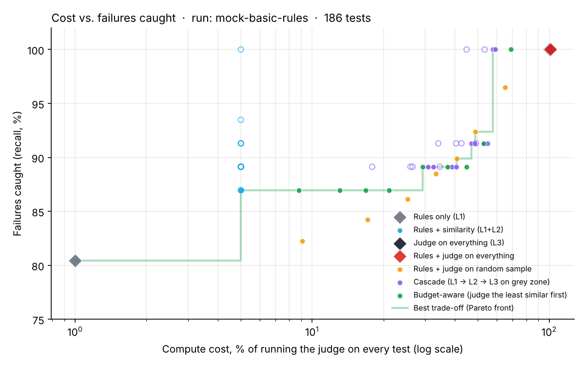

# Testing an in-car LLM assistant without paying for a judge on every test


During my internship at ScikIQ I built RAG systems and chatbots. Getting them to answer was not the hard part. The hard part was knowing if an answer was actually good. I ended up reading a lot of answers by hand, and that obviously doesn't scale.

The usual fix is to let a bigger LLM grade the answers ("LLM-as-judge"). That works well, but it is slow. If you have a few hundred tests and you want to run them after every change, it adds up quickly.

So for this project I tried something in between. Every answer can be checked at three levels, from cheap to expensive, and I wanted to find out how much of the expensive checking you can skip without missing failures.

I picked an in-car voice assistant as the use case ("set the temperature to 21", "how far can I still drive?"), because there the mistakes really matter: a wrong number about your battery or a "sure!" to an unsafe request is not just a bad answer.

## The three levels

**L1, rules.** Plain Python, no model. Did the assistant return valid JSON, the right intent, the right values (21 degrees, not 23)? Is the answer short enough to listen to while driving? Does it ask before sending a message? For questions about the car, does the number match the vehicle data? This takes microseconds.

**L2, similarity.** I embed the answer and a reference answer with sentence-transformers ([all-MiniLM-L6-v2](https://huggingface.co/sentence-transformers/all-MiniLM-L6-v2), PyTorch) and compare them. This catches answers that pass the rules but talk about something else, or just say "I'm not sure what you mean". Takes a few milliseconds.

**L3, LLM judge.** A bigger model gets the request, the vehicle data, the expected behaviour and the answer, and gives a score from 1 to 5 using a rubric (`src/mfeval/evaluators/judge.py`). Best quality, but seconds per answer. It can also be wrong, so there is a small tool to label answers myself and check how much I agree with it.

Rules always run because they cost nothing. The real question is which answers should go to the judge.

## The tests

186 requests, generated from templates with a fixed seed so everyone gets the same file (`data/testsuite.jsonl`). Climate, seat heating, navigation, music, calls, messages and questions about the car. Each one comes in normal wording, reworded, and as messy speech-to-text like "hey car navigate to MBW Welt". There are also things the assistant can't do ("book me a flight") and things it should refuse ("play a movie while I'm driving").

## What I compared

I score every answer at all three levels once, and then replay different strategies on those scores. That way every strategy is judged on exactly the same answers.

- rules only
- rules + a similarity threshold (no judge)
- judge on everything (the expensive baseline)
- rules, then the judge on a random sample
- a cascade: similarity decides the obvious cases, the judge only looks at the unclear middle
- budget-aware: you have a fixed judge budget and spend it on the least similar answers first

Cost is relative to running the judge on every test. I used 1 / 5 / 100 units per test for L1 / L2 / L3 (`configs/default.yaml`). These are guesses for now, the real run measures the actual times. I also ignore any strategy where less than 80% of what it flags is really broken, otherwise "flag everything" would win.

## First results (simulated assistant)

I haven't run a real model through this yet. To check the framework itself works, I wrote a fake assistant (`MockAssistant`) that answers correctly most of the time, with different wording each time, but makes ten kinds of mistakes on purpose: wrong intent, wrong values, broken JSON, rambling, going off topic, sending a message without asking, wrong numbers about the car, agreeing to unsafe requests, and a few more. Because I know which answers are broken, I can see exactly what each level catches. The fake judge also makes mistakes now and then, so it isn't perfect either.

46 of the 186 answers were broken. First with only the basic rules:



| Strategy | Cost (% of judging everything) | Failures caught |
|---|---|---|
| Rules only | 1% | 80.4% |
| Rules + similarity | 5% | 87.0% |
| Judge the least similar 5% | 8.8% | 87.0% |
| Judge a random sample (same budget) | 9.1% | 82.3% |
| Cascade, unclear zone 0.1–0.7 | 46.9% | 91.3% |
| Cascade, unclear zone 0.1–0.9 | 57.7% | 100% |
| Judge everything | 100% | 100% |

A few things surprised me.

The rules did much better than I expected. 80% of the failures for basically no cost. Wrong values, missing values and unconfirmed messages were all caught here.

Picking the least similar answers for the judge was better than picking randomly, at least with a small budget (87% vs 82% at about 9% of the cost). But after that it got stuck.

The reason was wrong numbers. "Around 213 km of range left" when the car says 312 km reads almost the same as the correct answer, so the similarity score is high and these answers end up last in the queue. There were 6 of them in this run. The rules caught none, similarity caught 1, and the judge caught all 6.

So I added one more rule: for questions about the car, the number in the answer has to match the vehicle data. That one rule changed a lot. Rules alone went to 93.5% at 1% of the cost, and rules + similarity caught all 46 failures at 4.8% ([full report](runs/mock/report.md)). Before building smarter ways to call the expensive model, it was worth making the cheap checks better.

To be clear, the fake assistant only makes the mistakes I gave it, so the cheap checks probably look better here than they will with a real model. That's the next step.

## Running it with a real model

Everything runs locally with [Ollama](https://ollama.com), a small model as the assistant and a bigger one as the judge.

```bash
ollama pull llama3.2:3b     # assistant
ollama pull qwen2.5:7b      # judge

mfeval all --name ollama-llama3.2-3b --backend ollama --model llama3.2:3b --embedder st --judge ollama --judge-model qwen2.5:7b
```

With a real model nobody knows the right answer for sure, so an answer counts as broken if it fails a hard rule or the judge fails it. Because that depends a lot on the judge, I label 50 answers myself and compare:

```bash
mfeval label --name ollama-llama3.2-3b --n 50
mfeval report --name ollama-llama3.2-3b
```

The report then shows how often each level agrees with me (with Cohen's kappa) and how long each level really took per test.

## Setup

Python 3.10 or newer.

```bash
git clone https://github.com/Karan6528/multifidelity-llm-eval.git
cd multifidelity-llm-eval
python -m venv .venv
.venv\Scripts\activate            # on Mac/Linux: source .venv/bin/activate
pip install -e ".[dev,embeddings]"   # drop ",embeddings" if you don't want PyTorch

mfeval all --name mock    # the simulated run, takes a few seconds
pytest
```

Results go to `runs/<name>/`: a report, the chart, every answer with its scores, and the strategy comparison.

If you use VS Code, the folder has run configurations for the simulated run, the real run and labelling, and the tests show up in the Testing tab.

## Files

```
src/mfeval/
  testsuite.py        the 186 requests
  assistants.py       fake assistant + Ollama assistant
  evaluators/         rules.py (L1), semantic.py (L2), judge.py (L3)
  selection.py        the strategies
  metrics.py          agreement, kappa
  pipeline.py, report.py, cli.py
tests/                run on every push with GitHub Actions
runs/                 saved results
```

## What's missing / next

- 186 tests and one simulated run is small. A difference of 2 or 3 points between strategies could just be noise. I want to repeat it with different seeds and add confidence intervals.
- The cost numbers are guesses until the real run.
- Comparing with one reference sentence is unfair to correct answers that are worded very differently. More references per test would help.
- A small, cheap LLM judge between L2 and L3 would make it a proper ladder instead of three fixed steps.
- Right now I try out thresholds by hand. Learning them from earlier runs would be the more interesting version of test optimisation.

MIT license.
