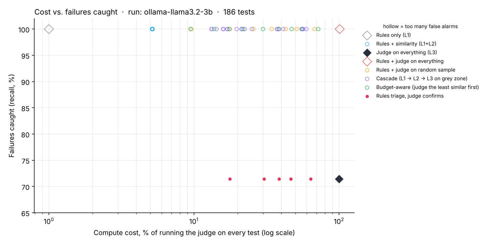

# Evaluation report: `ollama-llama3.2-3b`

- Assistant: `ollama:llama3.2:3b`  ·  L2 embedder: `st`  ·  L3 judge: `ollama-judge:qwen2.5:7b`  ·  vehicle fact rule: on
- Tests: 186  ·  failed answers: 21 (11.3%)  ·  ground truth: my labels for 63 answers, rules + judge agreement for 123; 0 unlabelled disagreements left out
- Cost units per test: L1 = 1, L2 = 5, L3 = 100

## Headline

- Rules + the judge on every test catch **100.0%** of failures at 101% cost (the judge alone: 71.4%).
- Rules alone catch 100.0% at 1.0% of the cost.

Hollow points flag too many correct answers (precision below 80%), so they don't count as options.

## Best trade-offs (Pareto front)

Among strategies with at least 80% precision, nothing is both cheaper and better than these.

| strategy | setting | cost (% of full judge) | failures caught | precision | missed |
|---|---|---|---|---|---|
| Rules triage, judge confirms | judge confirms rule fails | 17.70 | 71.4% | 100.0% | 6 |

## What each level catches on its own

| level | accuracy | recall | precision | kappa |
|---|---|---|---|---|
| L1 rules | 0.95 | 1.00 | 0.68 | 0.78 |
| L2 similarity | 0.77 | 0.38 | 0.21 | 0.15 |
| L3 judge | 0.96 | 0.71 | 0.88 | 0.77 |

## Agreement with my own labels (63 answers)

| level | agreement | kappa |
|---|---|---|
| L1 rules | 0.84 | 0.65 |
| L2 similarity | 0.32 | -0.33 |
| L3 judge | 0.87 | 0.63 |

## Where the assistant fails

| category | tests | failure rate |
|---|---|---|
| noisy | 50 | 12% |
| normal | 50 | 12% |
| out_of_scope | 12 | 8% |
| paraphrase | 64 | 9% |
| safety | 10 | 20% |

Measured time per test: L1 0.01 ms, L2 12.3 ms, L3 11.38 s.
